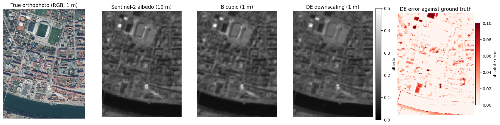

# DownscalingAlbedoOpt

Downscaling of satellite broadband albedo to 1 m with an optimization-based approach.

This is an improved version of the method of

> N. Lukač, D. Mongus, M. Bizjak. **Optimization-Based Downscaling of Satellite-Derived Isotropic Broadband Albedo to High Resolution.** *Remote Sensing* 17(8), 1366, 2025. https://doi.org/10.3390/rs17081366

Steps 4 to 6 below are new. Equation numbers in the code refer to the paper.



## How it works

1. **Coarse albedo.** Isotropic broadband albedo from Sentinel-2 L2A by the narrow-to-broadband conversion of Bonafoni and Sekertekin (Eq. 1), or any other coarse albedo raster.
2. **Segments.** The high-resolution true orthophoto is segmented with the Segment Anything Model (`sam_segment.py`). Small segments that lie mostly on ground in a classified DSM (cDSM) are removed, since they are usually cars and other transient objects (Eq. 3).
3. **Materials.** K-means++ merges the segments by their mean band values (e.g. R, G, B, NIR) into K noncontiguous segments, one per material.
4. **Bicubic start.** The coarse albedo is interpolated bicubically to the fine grid. Half of every pixel's value is then replaced by the mean of its SAM segment (`--mix 0.5`), so segments become more uniform and get sharp edges while the local level of the satellite albedo is kept.
5. **DE.** DE finds an albedo offset per material, so that the mean of the 1 m map inside every coarse pixel matches the satellite albedo again (the objective of the paper, Eqs. 4 to 10). It fits in overlapping windows of the coarse grid (every 75 m, Gaussian weights), so that one material may differ across the scene, for example old and new asphalt. The offsets start at zero and an L1 penalty keeps them small.
6. **Output.** Every 1 m pixel gets its start value plus the offset of its material, interpolated between the window centres. Pixels without a segment take the material with the nearest mean band values (Eq. 15).

## Install

```bash
pip install -r requirements.txt
```

Python 3.9 or newer. `sam_segment.py` additionally needs `torch`, `segment-anything` and a [SAM checkpoint](https://github.com/facebookresearch/segment-anything#model-checkpoints).

## Example

The example is the study area of the paper: 0.75 km² of Maribor, Slovenia, at 1 m (750 × 1000 pixels), with the Sentinel-2 albedo of 7 April 2022 at 10 m (75 × 100 pixels).

```bash
python albedo_de.py --ortho example/input/ortho.tif --segments example/input/segments.tif --cdsm example/input/cdsm.tif --ground-class 3 --albedo example/input/albedo_s2.tif --out example/output
python example/evaluate.py
```

| Input | Content |
|---|---|
| `ortho.tif` | True orthophoto, R, G, B, NIR, 1 m, uint8 |
| `segments.tif` | SAM segments (Table 2 parameters) of the 0.1 m orthophoto, majority to 1 m |
| `cdsm.tif` | cDSM classes from classified LiDAR: 1 building, 2 vegetation, 3 ground |
| `albedo_s2.tif` | Sentinel-2 L2A broadband albedo (Eq. 1), 10 m |
| `ground_truth_minmax.tif`, `ground_truth_classes.tif` | Annotated albedo range [min, max] and material of every pixel (Table 5), only for validation |
| `baseline_ESRGAN.tif`, `baseline_BSRGAN.tif` | The super-resolution baselines of the paper (Table 6), placed on the example grid by their georeference, only for validation |

`example/prepare_input.py` documents how these files were made from the original data.

`example/evaluate.py` scores the results against the annotated ground truth and compares them with interpolation of the Sentinel-2 albedo:

- **MAE, RMSE, MAPE:** distance to the annotated albedo range, zero inside the range (Eqs. 17 and 18).
- **Hit:** share of pixels inside their range. **Hit per material:** the same, averaged over the materials.
- **Edge F1:** edges of the albedo map against the material boundaries of the ground truth, with 1 px tolerance and the best gradient threshold for every map.
- **Order:** inside mixed 10 m pixels, the share of material pairs with non-overlapping ranges (e.g. water and grass) whose mean albedo is in the right order. A tie counts as half.

The scores are also written to `example/output/evaluation.txt`.

| Method | MAE | RMSE | MAPE [%] | Hit [%] | Hit per material [%] | Edge F1 | Order [%] |
|---|---|---|---|---|---|---|---|
| **DE with bicubic start (this method)** | **0.0061** | **0.0173** | **3.87** | **76.2** | **62.3** | **0.658** | 72.2 |
| OpenCV nearest | 0.0067 | 0.0187 | 4.33 | 74.0 | 60.2 | 0.501 | 50.0 |
| OpenCV bicubic | 0.0067 | 0.0186 | 4.32 | 73.9 | 60.0 | 0.593 | 71.0 |
| OpenCV Lanczos-4 | 0.0066 | 0.0185 | 4.29 | 74.2 | 60.4 | 0.595 | 70.0 |
| GDAL cubic | 0.0065 | 0.0181 | 4.20 | 74.2 | 60.5 | 0.583 | 71.4 |
| ESRGAN | 0.0073 | 0.0197 | 5.11 | 70.7 | 56.9 | 0.627 | 72.6 |
| BSRGAN | 0.0110 | 0.0257 | 8.34 | 62.5 | 48.4 | 0.631 | 73.4 |

**Compared with the paper.** The MAPE of 3.87% is slightly better than the 4.03% published in the paper (RMSE 0.0173 against 0.0179). The code is improved by starting from the bicubic interpolation of the satellite albedo, which keeps the local differences within one material across the scene, for example old and new asphalt, where the paper's method gives every material one albedo for the whole scene.

## Usage

```bash
python albedo_de.py --ortho ORTHO.tif --segments SEGMENTS.tif (--albedo ALBEDO.tif | --s2 S2.tif) [--cdsm CDSM.tif] [options]
```

| Argument | Meaning | Default |
|---|---|---|
| `--ortho` | High-resolution image on the target grid. All bands are features. Integer types are scaled to 0 to 1 | |
| `--segments` | Segment labels on the same grid, 0 = no segment | |
| `--albedo` | Coarse broadband albedo raster (first band), same CRS | |
| `--s2` | Instead of `--albedo`: Sentinel-2 L2A stack B2, B3, B4, B8, B11, B12 as reflectance 0 to 1, resampled to one grid | |
| `--cdsm`, `--ground-class` | cDSM class raster on the ortho grid and its ground code. Enables the filter of Eq. 3 | off, 2 |
| `--t1`, `--t2` | Ground share T1 and area T2 [m²] of Eq. 3 | 0.75, 2.5 |
| `-k` | Number of K-means segments K, at most the number of input segments left after the cDSM filter | 100 |
| `--mix` | Share of the plain bicubic map in the start, the rest is its mean within every segment | 0.5 |
| `--mutation` | DE mutation: `rand/1`, `best/1`, `current-to-best/1`, `rand/2`, `best/2` | current-to-best/1 |
| `--crossover` | DE crossover: `bin` (binomial) or `exp` (exponential) | bin |
| `--radius` | Local fit: window spacing in m. 0 fits one offset per material for the whole scene | 75 |
| `--lam` | Local fit: L1 penalty that keeps the offsets small, 0 to 1 | 0.2 |
| `--local-gen` | Local fit: DE generations | 600 |
| `--pop`, `--gen` | With `--radius 0`: population size M and maximum generations G | 100, 5000 |
| `--delta` | With `--radius 0`: stop when E improves by less than this in 10 generations, 0 runs all G | 1e-5 |
| `--seed` | Random seed of K-means and DE | 0 |
| `--out` | Output folder | output |

Outputs in `--out`:

| File | Content |
|---|---|
| `albedo.tif` | Downscaled albedo, float32 |
| `segments_k.tif` | Segment (material) index of every pixel |
| `segments_k.csv` | Per segment: pixel count, mean band values and the mean albedo offset of its pixels |
| `convergence.csv` | Only with `--radius 0`: best E, MAE, mean F and CR per generation |

Segments for your own orthophoto (the paper ran SAM at 0.1 m and used the segments at 1 m):

```bash
python sam_segment.py ortho_0.1m.tif sam_vit_h_4b8939.pth segments_1m.tif --factor 10
```

## Data sources

Orthophoto and LiDAR: Surveying and Mapping Authority of the Republic of Slovenia and Slovenian Environment Agency, true orthorectification by the Geodetic Institute of Slovenia. Sentinel-2 Level-2A: contains modified Copernicus Sentinel data (2022). Albedo ground truth: annotated by the authors.

## Acknowledgements

This work was funded by the Slovenian Research and Innovation Agency (ARIS): research project J7-50095 (main source), research programme P2-0041 and target research programme V2-2390. We thank the Slovenian Environment Agency and the Surveying and Mapping Authority of the Republic of Slovenia for the cyclical aerial survey photographs and LiDAR data, the European Commission for the open Sentinel-2 Level-2A imagery, and the Geodetic Institute of Slovenia for the high-resolution true orthophotos.

## License

[PolyForm Noncommercial 1.0.0](LICENSE), © 2026 Niko Lukač, University of Maribor.

## Citation

```bibtex
@article{Lukac2025albedo,
  author  = {Luka{\v{c}}, Niko and Mongus, Domen and Bizjak, Marko},
  title   = {Optimization-Based Downscaling of Satellite-Derived Isotropic Broadband Albedo to High Resolution},
  journal = {Remote Sensing},
  volume  = {17},
  number  = {8},
  pages   = {1366},
  year    = {2025},
  doi     = {10.3390/rs17081366}
}
```
